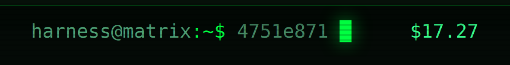

# dsh-matrix-terminal-balance

The host half of [dsh-matrix-terminal](https://github.com/victorcastro55/dsh-matrix-terminal).

It exposes one authenticated route that answers with the DeepSeek account balance behind the API key
the harness already configured. The key is resolved per request through the credential service, used
for a single outbound call, and never leaves the host process: the browser receives decimal strings
and nothing else.



```
GET /api/matrix-terminal.balance

{ "ok": true, "available": true,
  "wallets": [ { "currency": "USD", "total": "0.00", "granted": "0.00", "toppedUp": "0.00" } ] }
```

## What it does

- Resolves `DEEPSEEK_API_KEY` from the credential service — the same reference the model provider
  reads, so the number shown is the number being spent.
- Calls `https://api.deepseek.com/user/balance` with an 8 s timeout.
- Caches the last successful answer for 30 s, and shares one in-flight read between concurrent
  requests, so focus-driven refreshes in the UI do not each cost a request.
- Returns `{ ok: false, reason }` — `no-key`, `network`, `http-<status>` or `protocol` — instead of
  failing the route. The skin treats every failure as "no balance" and keeps the last known amount.

Nothing is logged beyond the plugin id, and no key material is written to any response, cache file
or log line.

## Requirements

- DeepSeek Harness `0.2.1-rc.5` or a compatible release, with the `connection` and `credentials`
  services (both are part of the stock host).
- An API key configured for the DeepSeek provider. Without one, the route answers `no-key` and the
  prompt line simply ends at the cursor.

## Install

```sh
dsh plugin --profile web add dsh-matrix-terminal-balance
```

Companion to `dsh-matrix-terminal`; installing it alone is harmless — the route exists and nothing
reads it. Installing the skin alone is also fine — the prompt line just omits the amount.

### From source

```sh
dsh plugin --profile web add github:victorcastro55/dsh-matrix-terminal-balance
```

## Using the route from your own plugin

The route is namespaced, owner-authenticated and stable; anything on the page can read it:

```js
const res = await fetch('/api/matrix-terminal.balance', { headers: { accept: 'application/json' } });
const body = await res.json(); // { ok, available?, wallets: [{ currency, total, granted?, toppedUp? }] }
```

`total` is the documented decimal string from the platform, not a number, so formatting stays exact.
The skin formats it as `<$0.01` below a cent, groups thousands, and joins multiple wallets with `+`.

## License

MIT. Not affiliated with DeepSeek. The balance endpoint is a documented platform API; using it
consumes no tokens.
